# demo-template-td1 (A changer en suivant le tutoriel)

## Modèle de dépôt pour la préparation du premier TD (15 minutes)

Ce modèle de dépôt présente les opérations basiques de construction d'un dépôt git que vous devez réaliser à l'occasion d'un nouveau TD du module d'AAP. 
Voici les étapes à effectuer qui ne devraient pas vous prendre plus de 15 minutes si vous avez correctement effectué votre préparation du TD1. 

1. Connectez-vous sur votre compte github 
2. Depuis l'interface de github, afficher settings -> Organisations pour accéder à la [page de vos organisations](https://github.com/settings/organizations). 
3. Une fois la page des organisations affichée, cliquez sur l'organisation AAP-26-27. 
    - Votre compte github doit avoir été invité à rejoindre l'organisation AAP-26-27, sinon elle ne sera pas visible...  
    - **Si ce n'est pas le cas, avez-vous bien renseigné le document partagé pour saisir vos identifiants github, comme demandé lors du cours 3 semaines avant le premier TD ?**
    - Une fois l'invitation reçue, l'interface des organisations vous permettra de l'accepter... 

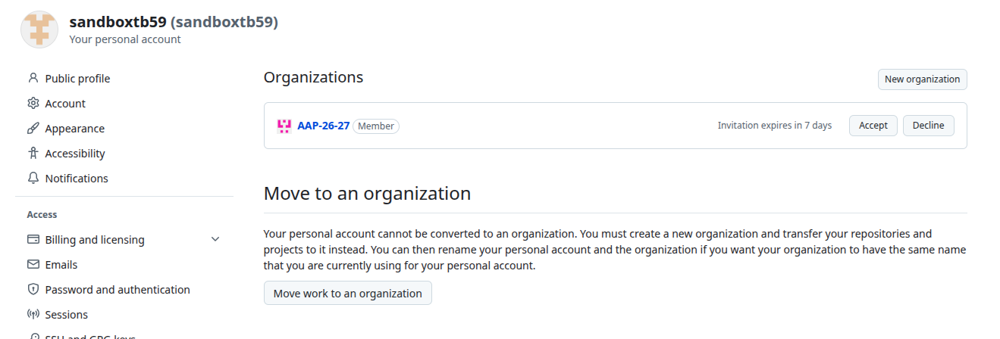
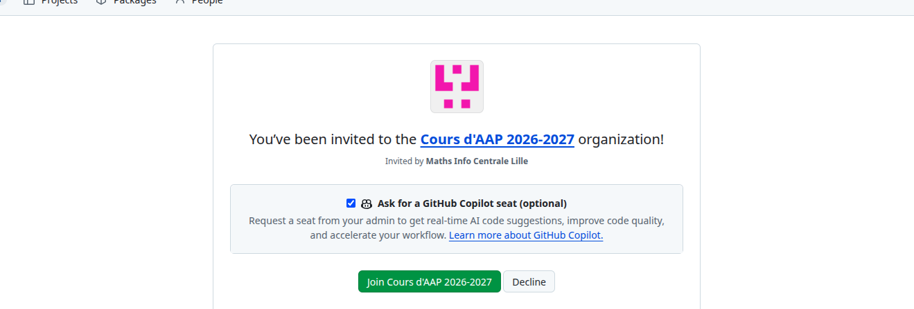
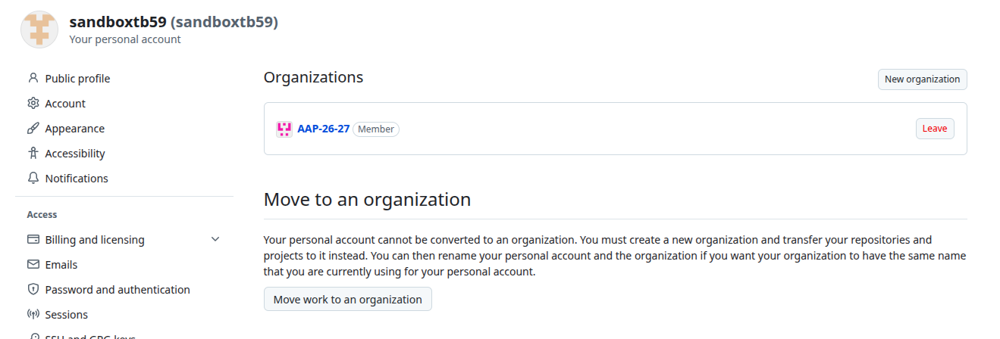

4. Dans l'organisation AAP-26-27, afficher les dépôts : cliquer sur le dépôt nommé "demo-template-td1"
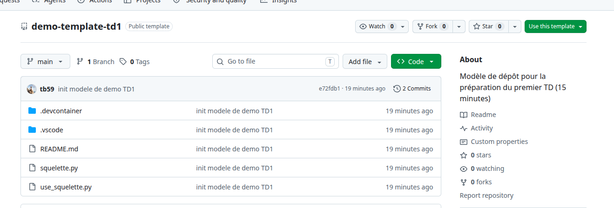

5. Il ne s'agit pas d'un dépôt comme les autres : c'est un *template* que vous allez pouvoir utiliser pour vous créer votre propre dépôt de travail personnel. Pour cela, dans l'interface du dépôt, cliquer sur *Use this template* et *Create a new repository*. 

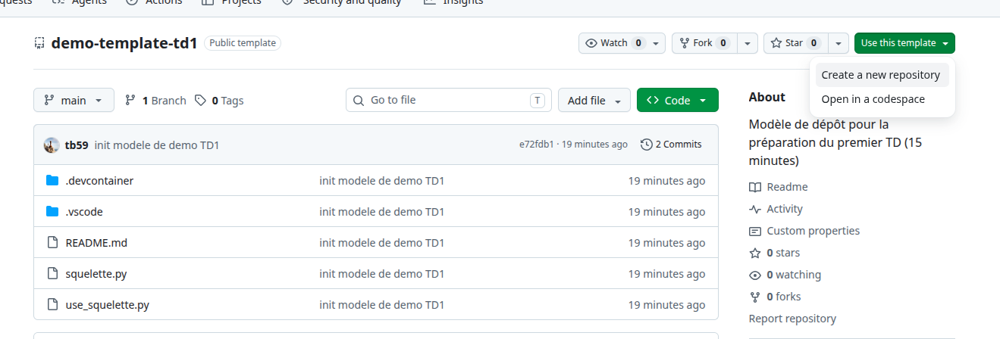

6. Dans **General/Owner**, choisir AAP-26-27, afin que votre dépôt appartienne à l'organisation
    - Si l'organisation AAP-26-27 n'apparait pas dans le menu déroulant owner... **C'est que vous n'êtes pas membre de l'organisation !** Cf. étape 3...

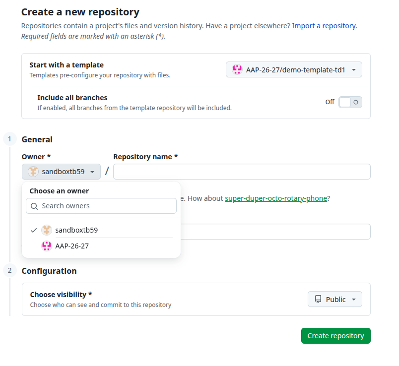

7. Dans **General/Repository name**, indiquez les informations suivantes : `numeroDeSeance-groupeTP-trigramme`
    - Le numéro de séance est la concaténation des lettres **TD** et du numéro de la séance concernée. Ici, puisque nous n'avons pas encore commencé le module, nous utiliserons **"TD0"** 
    - Le cas échéant, il est possible que l'on vous demande de créer un dépôt commençant par **"TP"**. Restez à l'écoute : le non respect des conventions de nommage entraînera des malus d'évaluation. 
    - Le groupe TP est votre numéro de groupe TP, par exemple **"A1"**, **"A2"**, **"B1"**, etc.
    - Le **trigramme** est un code composé de **trois lettres** utilisé pour identifier une personne, un projet ou une entité. Vous pouvez le bâtir en utilisant les premières lettres de vos noms et prénoms. 
    - À vous de le choisir, de manière unique dans votre groupe TP. Pour cela, enregistrez votre trigramme dans le document partagé utilisé pour la saisie des pseudos github. 
8. Dans **Description**, indiquez le contexte de votre travail. Ce champ est libre. 
9. Dans **Choose visibility**, choisissez **"Private"**. 
    - Il n'y a pas de raison de partager votre travail à vos camarades. 
    - Les enseignants, membre de l'équipe **"enseignants"** ont accès à tous les dépôts publics et privés de l'organisation. 

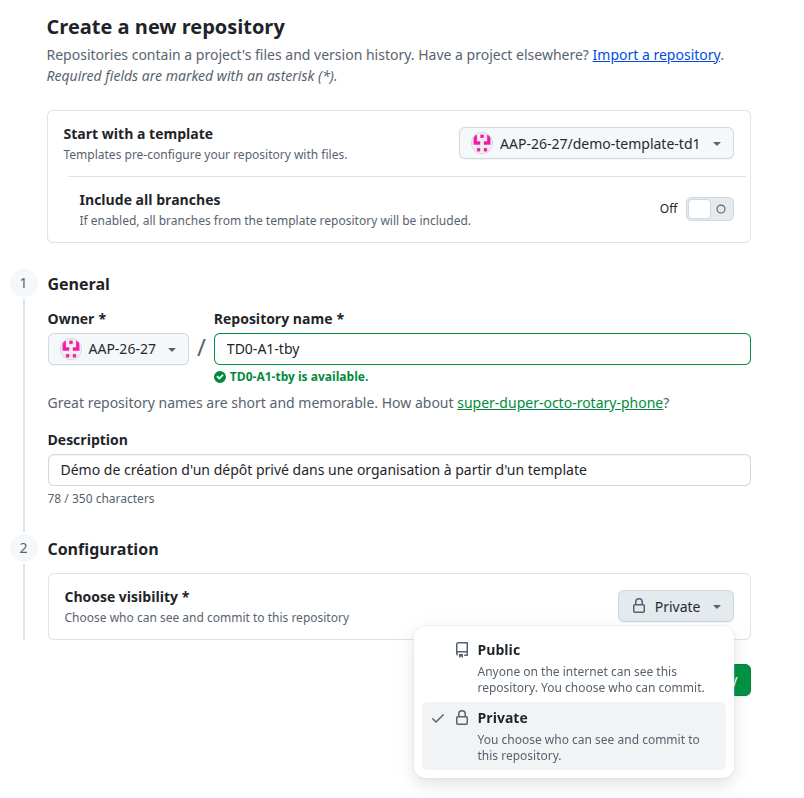

10. Une fois ces choix effectués, cliquer sur **Create repository**
11. Une fois le dépôt créé, son interface s'affiche dans votre navigateur. Cliquer sur le bouton **"<> Code"** et choisissez l'onglet **"Codespaces"**. 

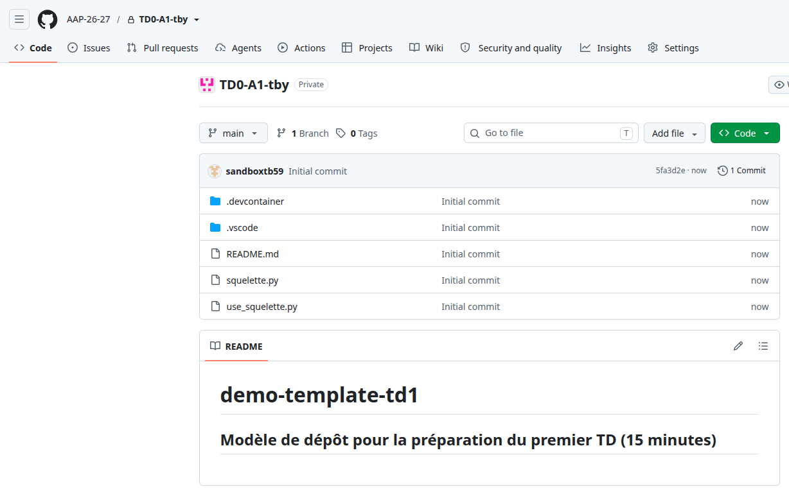
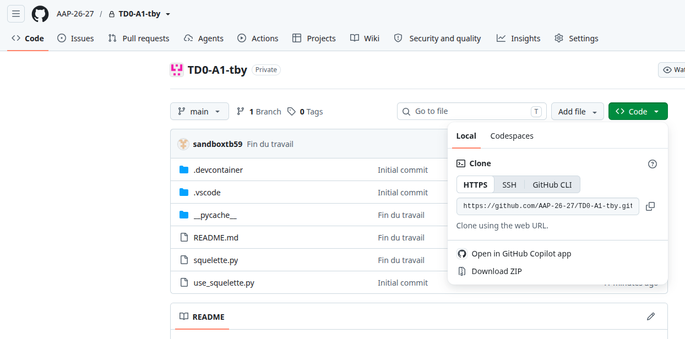
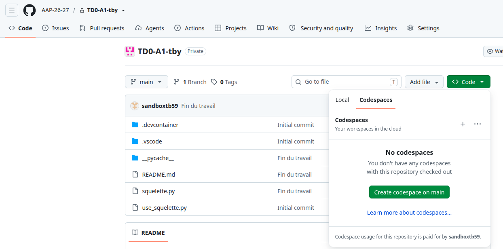

12. Cliquer sur **"Create codespace on main"** pour ouvrir l'interface de github Codespace dans votre navigateur : Visual Studio Code s'affiche dans votre navigateur pour rédiger vos programmes, une machine virtuelle démarre pour héberger et exécuter vos programmes. 
    - L'initialisation d'un Codespace prend un peu de temps la première fois (2 minutes environ), le temps de créer l'image de la machine virtuelle hébergeant le dev container. 
    - Une fois cela fait, tant que vous ne détruisez pas le Codespace (et même si vous l'arrêtez), l'image reste stockée dans votre espace github. Cela consomme votre espace de stockage mais permet de redémarrer le codespace beaucoup plus rapidement ensuite. 
13. Une fois la machine virtuelle démarrée, cliquer sur **"Approuver le dossier et continuer"**. 

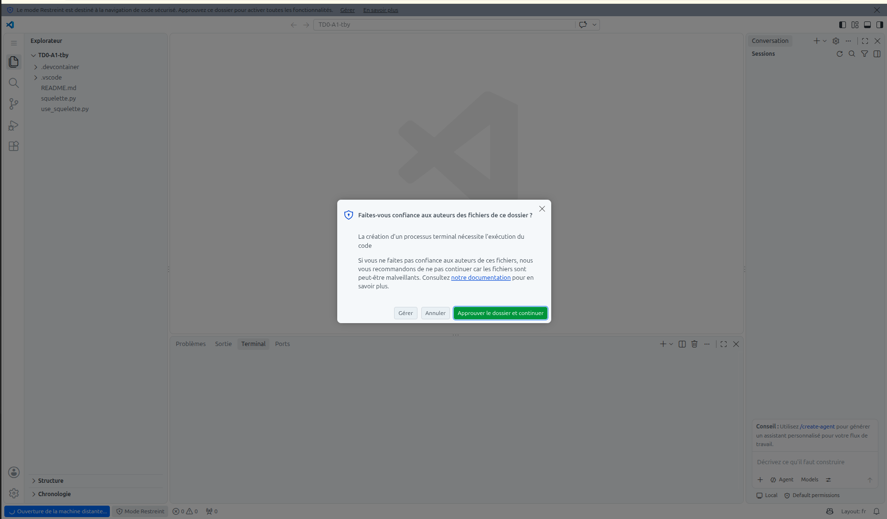

14. Modifier le fichier README pour changer le nom du dépôt que vous êtes en train d'utiliser, de "demo-template-td1" à `numeroDeSeance-groupeTP-trigramme`. Modifier à votre guise le reste du fichier. 
15. Modifier le code python de sorte que la fonction `foo` affiche "hello world !". 
16. Comprendre et tester les codes des fichiers `squelette.py` et `use_squelette.py`.

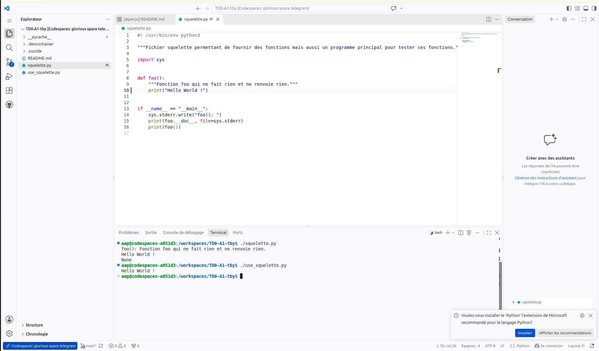

17. Enregistrer votre travail dans votre dépôt github à l'aide des commandes `git add`, `git commit` et `git push`. 

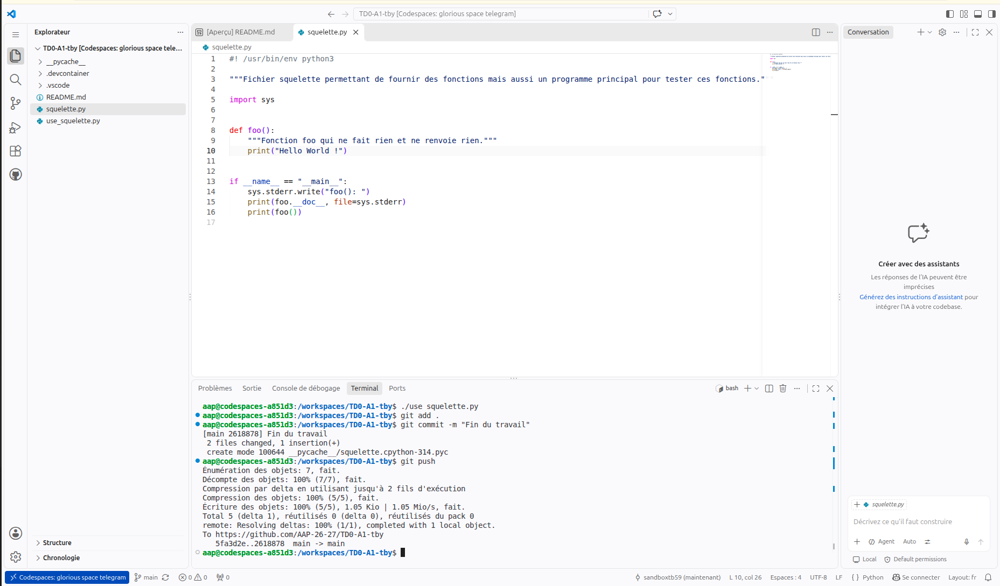

18. Fermer Codespaces. Pour cela :
    - Ouvrir la palette de commandes avec Ctrl + Shift + P (Cmd + Shift + P sur Mac).
    - Rechercher **"Codespaces: Stop Current Codespace"**.
    - Valider l'arrêt.

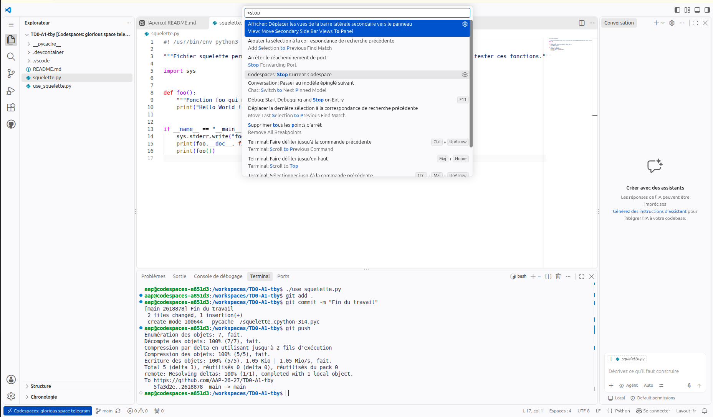

19. Revenir à l'interface Web affichant votre dépôt (cf. étape 11). Actualiser votre navigateur et vérifier que les modifications réalisées dans les étapes précédentes ont bien été sauvegardées et que les messages de commit apparaissent. 

